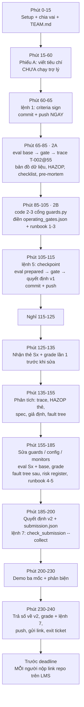

# Workflow · LAB 10 · From PoC to Pilot (Gate 1)

Bàn: `Nhom4Nguoi` · Lớp `L3B` · Repo: `K5-L3B-DAY10-Nhom4Nguoi-PoCtoPilotGate1` · 4 người · 240 phút.
Nguồn: `README.md`, `problem-set.md`, `CHECKPOINTS.md`, `RUBRIC.md`, `RULES.md`, `SUBMISSION.md`, `docs/guide.md`.

## 0. Tóm tắt một dòng

Ký tiêu chí **trước** khi đo → đo base → tìm rủi ro → dựng cổng vòng 1 → chốt (prepared) → bốc thẻ sự cố → sửa → quyết định v2 khớp bằng chứng → gom bài → nộp.

## 1. Phân vai (4 người)

| Người | Vai | Việc chính | File chính |
|---|---|---|---|
| P1 (trưởng nhóm) | Kỹ sư cổng 1 | Lệnh eval/gate/trace, `pre_guard`/`write_gate`, trace sự cố | `lab10/guards.py` |
| P2 | Kỹ sư cổng 2 | `monitors.py`, behavioral test (câu 2.8), chạy ba mốc, hỗ trợ trace | `lab10/monitors.py` |
| P3 | Sản phẩm và kinh doanh | Tiêu chí, bản đồ dữ liệu, cổng `business`, quyết định v1/v2 | `config/acceptance_criteria.json`, `operating_gates.json` (business), Phiếu A, B8, C12 |
| P4 | Vận hành và pháp lý | HAZOP, checklist 9 nhóm + PIC, runbook, `operations`/`legal`, gom bài | `operating_gates.json` (operations, legal), `submission/submission.json` |

Mọi quyết định (v1, v2) do cả bàn chốt. Ai cũng đọc trace cùng Kỹ sư cổng.

## 2. Flow tổng thể



## 3. Chi tiết từng giai đoạn

### GĐ 0 · Setup (phút 0-15) · CP1
- [ ] Repo đúng tên `K5-L3B-DAY10-Nhom4Nguoi-PoCtoPilotGate1`, fork Public, mời cả bàn quyền Write.
- [ ] `git config user.name "<mã học viên trưởng nhóm>"`, `user.email "<mã>@example.com"` (không dùng email cá nhân).
- [ ] Điền bảng thành viên `TEAM.md` (họ tên, MSSV, vai).
- [ ] Chọn eval card + PRD v1.1 từ Lab 9 làm bản chung.
- [ ] `python -m unittest discover -s tests` → `Ran 13 tests … OK` (Windows dùng `python`).
- **Xong khi:** test OK, `git remote -v` có `origin`.

### GĐ 1 · Tiêu chí và ký (phút 15-65) · CP2 · Phiếu A
Chưa chạy `lab10.eval`.
| Câu | Ai | Nội dung |
|---|---|---|
| 1.1, 1.2 | P3, P4 | Mục tiêu hệ thống; mục tiêu của chị Oanh (đối soát), chị Hạnh (trưởng ca) → A1 |
| 1.3 | P1/P2 | 1 offline metric cho 1 bước agent (thước đo → dữ liệu → cách tính) → A2 |
| 1.4 | P4 | Telemetry production + khung thời gian + ngưỡng báo động → A2 |
| 1.5 | cả bàn | Đọc khoảng tin cậy → chọn (b) (chênh 1 lần chạy nằm trong CI của X) → A3 |
| 1.6 | P3 | Câu "Nếu … thì chúng tôi sẽ …", bốn câu soát, 2 câu ranh giới đầu ra → A4 |

Điền `config/acceptance_criteria.json`: `team` (= tên repo), `signed_by`, 5 ngưỡng `required`, `escalation_rate_max`, `business_ops` (cost, roi, queue_stuck), `stop_condition`, 4 dòng `decision_rule`. Tham khảo `.example.json`, **không chép ngưỡng**; số kinh doanh lấy từ `data/world.json` → `ops_facts`.

Ký (một lần): `python -m lab10.criteria sign`, rồi chạy đúng dòng git máy in ra:
`git add config/acceptance_criteria.json config/acceptance_criteria.lock && git commit -m 'Sign acceptance criteria' && git push -u origin main`
- Ghi A5 (giờ ký, mã commit). **Từ đây không sửa file tiêu chí (một dấu cách cũng đổi hash).**

### GĐ 2A · Đo và tìm rủi ro (phút 65-85) · Phiếu B
Ba vai song song 10 phút, rồi pre-mortem cả bàn 10 phút.
- P1 · **2.1 (B1, B0)**: `python -m lab10.eval --suite base --stage base --note "baseline"` → `python -m lab10.gate --run runs/<mã>/report.json`. Đọc khối kinh doanh/vận hành và "theo kho và hãng". Khoanh khuyến nghị tự chặn / người duyệt / kết hợp.
- P1 · **2.2 (B2)**: `python -m lab10.trace --suite base --ticket T-002 --seed 55` → bảng soát lỗi.
- P3 · **2.3 (B3)**: bản đồ dữ liệu + 1 ví dụ drift (xem `data/world.json`: `policies`, `orders[].parcels`, `ops_limits`, `ops_facts`).
- P4 · **2.4 (B4, B5)**: HAZOP ≥ 3 dòng + ≥ 2 dòng ngoài kỹ thuật; checklist 9 nhóm, mỗi dòng 1 PIC có tên.
- Cả bàn · **2.5 (B6)**: pre-mortem 4 lăng kính (kỹ thuật, kinh doanh, con người/vận hành, pháp lý); chọn 2-3 lý do thành cổng.
- **Xong khi:** có mã lần chạy base; `T-002@55` được xếp loại; pre-mortem đủ 4 lăng kính.

### GĐ 2B · Dựng cổng (phút 85-105)
- P1 · **2.6 (B7.1)**: 2-3 cổng trong `lab10/guards.py` (`pre_guard` trước khi đọc ticket; `write_gate` trước `issue_refund`/`file_carrier_fault`/`notify_carrier`/`send_reply`). Chèn kiểm tra trước `return Verdict.allow()`. Không xử lý riêng theo mã ticket/câu chữ cụ thể.
- P1 · **2.7 (B7.2)**: 2 bước tránh rò rỉ dữ liệu (không chỉnh cổng chỉ để xanh 22 ticket nền; nhớ có test ẩn + gói sự cố).
- P1+P2 · **2.8 (B7.3)**: 1 tính chất + 2 ticket hiểm chạy bằng `--adhoc`; giữ làm "ticket hiểm" cho demo.
- P3 · **2.9 (B7.4)**: `business.*` (`daily_refund_cap_vnd`, `cost_budget_per_ticket_vnd`, `pilot_scope`, `roi_min`), mỗi số một câu lý do.
- P4 · **2.10 (B7.5, B7.6)**: `operations.*` (`pic` không để trống, `approver_id`, `reviewers_on_shift`, `review_capacity_per_hour`, `max_queue_wait_minutes`, `stop_conditions`, `alert_channel`) + `legal.*`; runbook 1-3 + mục Giờ cao điểm **khớp số trong config**.
- Kiểm tra:
  ```
  python -m lab10.eval --suite base --stage after --note "cổng vòng 1: ..."
  python -m lab10.trace --suite base --stage after --adhoc "..." --order O-10xx --customer C-xx
  python -m unittest discover -s tests
  ```
- **Xong khi:** không có ca mới hỏng so với base; test OK; `operations.pic` đã điền.
- Bẫy: không "cho chắc thì chuyển người" (ùn hàng chờ, tăng chi phí); không xếp quá nhiều người trực (ROI âm).

### GĐ 2C · Chốt vòng 1 và quyết định v1 (phút 105-115) — đúng thứ tự
1. `python -m lab10.checkpoint` (một lần; tạo `guards_round1.py`, `operating_gates.round1.json`, `round1.lock`).
2. `python -m lab10.eval --suite base --stage prepared`
3. `python -m lab10.gate --run runs/<mã>/report.json`
4. Điền cột v1 ở B8: 1 quyết định, 3 bằng chứng có mã lần chạy, dòng `decision_rule`, kho/hãng xấu nhất, ngày quyết định lại.
5. Commit + push (lệnh cuối B8). Sau mốc này v1 không sửa được; không sửa hai bản chụp round1.

### Nghỉ (115-125)

### GĐ 3 · Sự cố (phút 125-185) · CP4 · Phiếu C
**125-135 · Nhận thẻ (3.0).** Lab Coach báo số thẻ. Chạy từng dòng (thay `Sx`):
```
git fetch https://github.com/VinUni-AI20k/K5_L3_Day10_PoC-to-Pilot_Gate1_cards.git main
git checkout FETCH_HEAD -- incidents/Sx
git commit -m "Nhận thẻ Sx"
python -m lab10.grade --incident Sx
git push -u origin main
```
Ghi `Thẻ đã bốc: Sx` ở đầu Phiếu C và `TEAM.md`. Điền C0, C1. Chỉ làm đúng thẻ của bàn. **Xong khi:** `1 integrity ✅` và dòng "Thẻ đã bốc … khớp".

**135-155 · Phân tích (3.1-3.4).**
- Trace ≥ 2 ticket hỏng khác kiểu: `python -m lab10.trace --suite Sx --ticket Sx-01 --seed 11` (P1/P2).
- C2 bảng soát lỗi (≥ 2 lỗi nguồn khác nhau, ≥ 1 lỗi chìm) · C3 phần riêng thẻ (S4 bỏ qua) · C4 HAZOP thẻ ≥ 3 dòng (P4) · C5 specification (P3) + giả định môi trường (P4) · C6 fault tree trước khi sửa, lá có bằng chứng `ticket@seed`.

**155-185 · Sửa (3.5-3.7).** Đúng chỗ cho từng nguyên nhân:
| Nguyên nhân | Sửa ở | Ai |
|---|---|---|
| Kỹ thuật | `lab10/guards.py` (giữ cổng cũ, thêm cổng mới) | P1 |
| Chỉ số theo dõi mới (≥ 1 hàm, đăng ký `MONITORS`; `escalation_rate` không tính) | `lab10/monitors.py` | P2 |
| Tiền, phạm vi | `config/operating_gates.json` → `business` | P3 |
| Người, quy trình, pháp lý | `operations`, `legal` | P4 |
```
python -m lab10.eval --suite Sx --stage after --note "đổi MỘT thứ: ..."
python -m lab10.eval --suite base --stage after --note "kiểm lại bộ nền sau khi sửa"
python -m lab10.grade --incident Sx
```
Mỗi lần chỉ đổi **một** thứ để biết cái nào có tác dụng. Điền C7 (giảm vs ngăn), C8 (chỉ số mới: thước đo → dữ liệu → cách tính), C9 (fault tree sau), C10 (≥ 1 risk register), C11 (checklist + runbook 4-5).
- **Xong khi:** `monitor ✅`, `regression ✅`, `visible ✅`; biết còn vượt trần nào và có "được phép cân nhắc Tiếp tục" không.
- Bẫy: chặn hết / thu hẹp về 0 / thêm quá nhiều người trực **không** phải cách sửa.

### GĐ 4 · Quyết định v2 và gom bài (phút 185-200) · CP5
- C12: quyết định, đổi/giữ so với v1 và vì con số nào, mã lần chạy 3 mốc, **3 dòng bắt buộc** (giả định môi trường có thể sai; cổng chỉ GIẢM hay NGĂN; cần đo lại gì trong pilot thật vì data là mock). Phải gắn con số.
- Quy tắc: **Tiếp tục** khi còn vượt trần hoặc ngưỡng đã ký chưa đạt = **không đạt**. Thu hẹp (ghi kho nào, % còn lại, mấy người trực, ticket cắt đi đâu) / Cải tiến thêm (giả thuyết cụ thể, có hạn) / Dừng (ghi bài học) có số thì đều đạt.
- `submission/submission.json`: `team` (= tên repo), `members` dạng `HoVaTen-MSSV`, `incident`, `decision_v1`, `decision_v2`, `three_lines`.
- `python -m lab10.check_submission --collect` → sửa từng `[THIẾU]` tới khi in `ĐỦ THÀNH PHẦN`.

### GĐ 5 · Demo, nộp (phút 200-240)
- Demo 5 phút/bàn (ghép cặp cùng thẻ): chiếu 3 cột base · prepared · after; nói cổng vòng 1 đã đỡ gì, phần sửa là code/số/người và vì sao, con số đỡ cho v2. Bàn kia phản biện bằng ticket hiểm hoặc đổi 1 con số.
- Sau demo: **trả mọi số đã đổi thử về bản v2**, chạy lại `grade --incident Sx` và lệnh 7 (không thì lệnh 7 báo "không chạy trên đúng code và config hiện tại").
- Đẩy bài:
  ```
  git add -u
  git add submission templates TEAM.md
  git commit -m "LAB 10: bài nộp"
  git push -u origin main
  ```
- Gửi link repo cho team chấm; mỗi người viết exit ticket trong mục cá nhân `TEAM.md` (ghi rõ phần đã dùng AI).
- **Deadline LMS (GMT+7), mỗi người tự nộp link repo:** lab sáng 23h59 cùng ngày; lab chiều/tối 11h59 hôm sau. Lab này là L3B (kiểm tra buổi học của lớp để biết mốc đúng).

## 4. Điều kiện qua (không đạt = bài không được tính)

1. Ký tiêu chí **trước** lần eval đầu tiên, không đổi sau khi ký (git history + `.lock` + `runs/journal.jsonl`).
2. File khoá và bản chốt vòng 1 còn nguyên (`1 integrity ✅`).
3. Quyết định v2 khớp bằng chứng và tiêu chí đã ký.
4. Lệnh 7 in `ĐỦ THÀNH PHẦN`.

## 5. Thang điểm (100 + bonus 10)

| Tiêu chí | Điểm | Phiếu |
|---|---:|---|
| C1 Tiêu chí và cách đo | 15 | A |
| C2 Rủi ro trước sự cố | 15 | B1-B6 |
| C3 Cổng vòng 1 và v1 | 15 | B7-B8 |
| C4 Máy đo trên thẻ + test ẩn | 25 | report ba mốc |
| C5 Phân tích và sửa sự cố | 20 | C2-C11 |
| C6 Quyết định v2 + 3 dòng | 10 | C12 |
| Bonus: prepared gần after (+5); chỉ số/cổng bắt được lỗi chìm ngoài thẻ (+5) | +10 | |

Trừ điểm: thiếu TEAM.md/mục cá nhân (người đó mất điểm cá nhân); `members` thiếu MSSV/không khớp (-5); sai tên repo hoặc `team` không khớp (-5).

## 6. Luật cần nhớ

- Ký trước khi đo; push ngay; không sửa tiêu chí sau ký (đừng mở rồi lưu bằng editor tự format).
- Không sửa file khoá (`lab10/*` trừ `guards.py`, `monitors.py`; `data/`, `tests/`, `incidents/`, hai bản chụp round1).
- Có test ẩn (đơn/khách/câu chữ/ngày khác): không xử lý theo mã ticket hay câu chữ cụ thể.
- Không làm hỏng ca đang đúng (regression).
- Chỉ làm đúng thẻ đã bốc; không xem/tiết lộ thẻ bàn khác.
- Mọi con số trong tiêu chí và config là của bàn: phải giải thích được lúc demo.
- Không commit secret/`.env`; không sao chép bài bàn khác; không mở PR về repo mẫu.
- Windows/PowerShell: gõ từng lệnh một dòng (không dùng `&&` ở PowerShell cũ); dùng `python` thay `python3`.

## 7. Checklist nộp cuối

- [ ] Repo đúng tên, Public
- [ ] `TEAM.md` đủ bảng + mục cá nhân của từng người
- [ ] Tiêu chí ký + push trước eval đầu tiên
- [ ] Đã chạy checkpoint (lệnh 5) trước phút 115
- [ ] Phiếu A (A1-A5), B (B0-B8), C (C0-C12) đủ; `Thẻ đã bốc:` đúng
- [ ] `submission/submission.json` đủ trường
- [ ] Lệnh 7 → `ĐỦ THÀNH PHẦN` trên code/config cuối
- [ ] `submission/runs/` có `journal.jsonl`, `grade-report.*`, report ba mốc
- [ ] Mỗi thành viên nộp link repo trên LMS

---

## 8. Trạng thái triển khai (cập nhật 2026-11-19)

Giai đoạn 3 chưa phải cuối. Sau thẻ sự cố còn: quyết định v2, `submission.json`, lệnh 7 (GĐ 4), demo và nộp (GĐ 5).

| GĐ | Trạng thái | Bằng chứng |
|---|---|---|
| 0 Setup | Xong | Test `Ran 13 tests … OK`; `TEAM.md` điền 4 người; git user = mã học viên trưởng nhóm |
| 1 Tiêu chí và ký | Xong | Ký 2026-11-19 14:30:27, hash `5137c9c0`, commit `abaffa2` (có trên `main`); Phiếu A đủ A1 đến A5 |
| 2A Đo, rủi ro | Xong | Base `R-base-before-20261119-143130-bde05c`: pass_rate 0,9909, pass_k 0,9545, hỏng `T-002@55`; Phiếu B B0 đến B6 |
| 2B Cổng vòng 1 | Xong | 3 cổng trong `lab10/guards.py`; `operating_gates.json` điền đủ; runbook 1 đến 3 và giờ cao điểm; 2 ticket hiểm |
| 2C Chốt và v1 | Xong | Hash chốt `44c8d63e`; prepared `R-base-prepared-20261119-144513-5e2912`; v1 = Tiếp tục (có điều kiện: chưa kiểm trên gói sự cố) |
| 3 Sự cố | **Chờ thẻ** | Cần số thẻ Sx từ Lab Coach ở phút 125 |
| 4 v2 và gom bài | Chưa | |
| 5 Demo và nộp | Chuẩn bị | `demo.md`, `demo-slides.html` (phần thẻ còn để trống) |

### 8.1 Ba cổng đã code (`lab10/guards.py`, hàm `write_gate`)

| # | Tool | Quy tắc | Chặn gì |
|---|---|---|---|
| 1 | `issue_refund` | Số tiền ≤ quyền lợi tính từ DB (tracking, nguyên nhân, chính sách hiệu lực theo ngày) trừ phần đã hoàn trong sổ cái; sai thì `deny` hoặc `modify` số tiền và người trả | Số ngày khách tự khai (`T-002@55`), lệnh cài trong ghi chú, hoàn trùng khi retry |
| 2 | `file_carrier_fault` | Chỉ ghi khi DB ghi nguyên nhân thuộc lỗi hãng và đủ ngày; ghi đúng kiện, hãng, tài xế, số ngày; tối đa 2 lỗi tự động mỗi hãng mỗi ngày | Lỗi oan cho hãng, ghi nhầm kiện đơn nhiều kiện |
| 3 | `notify_carrier` | Chỉ giữ các trường trong `carrier_notice_fields` của chính sách hiệu lực | Dữ liệu cá nhân (ghi chú khách, liên hệ người nhận) rời LogiX |

Không có nhánh theo mã ticket hay câu chữ cụ thể (luật test ẩn).

### 8.2 Con số đã đặt (`config/operating_gates.json`) và lý do

| Khoá | Giá trị | Lý do |
|---|---|---|
| `business.daily_refund_cap_vnd` | 1.000.000 | 50% ngân sách Finance 2.000.000đ; gấp hơn 6 lần ngày thường (155.000đ) |
| `business.cost_budget_per_ticket_vnd` | 1.200 | Dưới trần LLM 1.500đ; ticket đắt nhất 770đ |
| `business.pilot_scope` | all | Mọi kho pass_rate 1,0 sau cổng; xem lại ở vòng 2 |
| `operations` | PIC NV-TUNG, duyệt NV-HANH, 1 người trực, 6 ca/giờ, chờ tối đa 45 phút | Khớp `staff` và `staff_behavior.trust_conditions` |
| `operations.decision_note` / `review_sampling_pct` | true / 10 | Điều kiện để nhân viên tin trợ lý |
| `legal` | chặn 5 trường dữ liệu cá nhân; ghi lỗi hãng phải có nguyên nhân | Bên thứ ba: hãng, người nhận quà |

### 8.3 Ba mốc đã có (bộ nền 22 ticket × 5 seed)

| Chỉ số | base | prepared |
|---|---|---|
| pass_rate / pass_k | 0,9909 / 0,9545 | 1,0 / 1,0 |
| Hoàn sai · lỗi oan hãng · lộ dữ liệu | 20.000đ · 1 · 0 | 0 · 0 · 0 |
| Chi phí mỗi ticket · ROI | 4.203đ · 1,34 | 4.456đ · 1,24 |
| Vượt trần | không | không |

Cột `after` điền sau khi sửa thẻ sự cố.

### 8.4 Sự cố đã gặp và cách xử lý

- **Hash tiêu chí đổi do CRLF.** Git Windows bật `core.autocrlf=true`, checkout ghi file với CRLF nên hash `912faddb` thay vì `5137c9c0`. Đã tắt autocrlf cho repo này, khôi phục LF, chạy lại base. Dùng mã `…143130…`; mã `…143100…` ghi cảnh báo, không dùng làm bằng chứng.
- **`integrity` báo lỗi** vì 19 file bị khoá ở dạng CRLF từ lúc clone. Đã đưa về LF, hiện `integrity` đạt. Không để autocrlf bật lại.
- **Nhánh:** làm trên `demo`, đã push `origin/demo`; `main` giữ ở commit ký `abaffa2` và được merge sau. Team chấm đọc `main`, nên phải merge `demo` vào `main` trước khi nộp.

### 8.5 Việc còn lại

1. Phút 125: nhận thẻ Sx, ghi `Thẻ đã bốc:` ở Phiếu C và `TEAM.md`, chạy `grade --incident Sx` trước khi sửa (C0, C1).
2. Phân tích C2 đến C6, sửa `guards.py`, `operating_gates.json`, thêm ít nhất một hàm trong `lab10/monitors.py`; chạy `eval` Sx và base, `grade`.
3. C7 đến C11, quyết định v2 (C12), `submission/submission.json`, lệnh 7 tới `ĐỦ THÀNH PHẦN`.
4. Điền cột `after` và phần thẻ trong `demo-slides.html`, `demo.md`.
5. Mỗi người viết mục cá nhân trong `TEAM.md`; merge `demo` vào `main`; mỗi người nộp link repo trên LMS.
